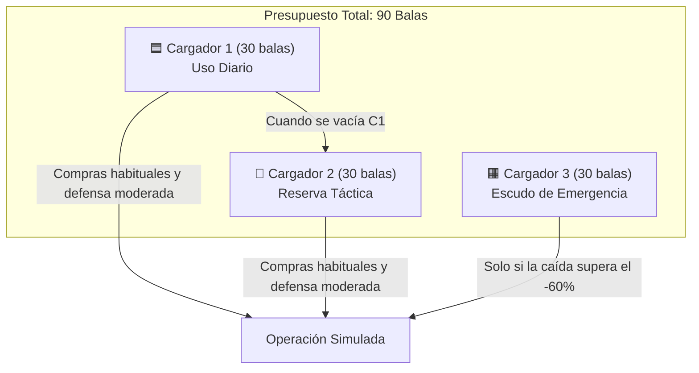
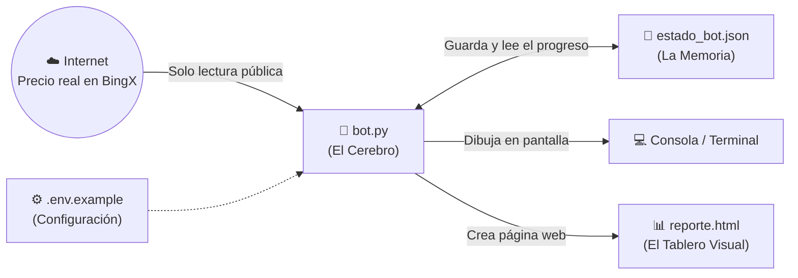

# 🌐 Guía del Ecosistema — Explicado desde Cero (Para Todo Público)

> **¿Para quién es este documento?**  
> Si nunca invertiste en criptomonedas, no sabés qué es un "futuro perpetuo", un "margen aislado" o una "API", esta guía está pensada para vos. Acá te explicamos paso a paso qué hace este proyecto, por qué existe y cómo encajan todas sus piezas usando analogías simples.

---

## 1. La Idea en 30 Segundos (Analogía)

Imaginá que querés comprar un producto cuyo precio sube y baja todos los días (en este caso, **Bitcoin**):

1. En vez de gastar todo tu presupuesto el primer día y rezar para que suba, dividís tu dinero en **90 partes iguales** (a las que llamamos **"balas"**) y las guardás en **3 cajas ("cargadores") de 30 balas cada una**.
2. **Día 1:** Comprás un poquito (usás solo **2 balas**).
3. **Si el precio sube lo suficiente (+15% de ganancia):** Vendés todo, guardás la ganancia y volvés a llenar tus 3 cajas con 90 balas para empezar de nuevo.
4. **Si el precio baja:** Aprovechás que está más barato para comprar un poco más (1, 2 o 3 balas según cuánto haya bajado). Al comprar más barato, **tu precio promedio de compra baja**, por lo que necesitás un rebote mucho menor para salir ganando.
5. **Si el precio se desploma fuerte:** Dejás de comprar y usás las balas de reserva como "escudo" para proteger tu cuenta y evitar perder lo invertido.

Este programa (`bot.py`) **automatiza esa lógica matemática**, pero **jugando con dinero ficticio (simulado)** mientras lee el precio real de Bitcoin en vivo desde internet.

---

## 2. Diccionario Básico (Sin Tecnicismos)

Antes de ver cómo funciona el sistema por dentro, traduzcamos los 6 conceptos clave que vas a ver en la pantalla:

| Término en el Bot | ¿Qué significa en la vida real? |
|---|---|
| **BTC / USDT** | **BTC** es Bitcoin. **USDT (Tether)** es un "dólar digital" que siempre vale ~1 dólar estadounidense. Cuando dice `BTC: 74,500 USDT`, significa que 1 Bitcoin cuesta 74.500 dólares. |
| **BingX** | Es la casa de cambio digital (*exchange*) de donde el programa consulta cuánto vale Bitcoin en este exacto segundo. |
| ** Estrategia DCA** | Siglas de *Dollar Cost Averaging* (Promediar el costo). Es la técnica de comprar en varias partes a distintos precios para conseguir un mejor precio promedio. |
| **Posición LONG (Largo)** | Significa apostar a que el precio **va a subir**. Ganás si Bitcoin sube por encima de tu precio promedio de compra. |
| **Apalancamiento 5X y Margen Aislado** | El exchange te "presta" fuerza de compra multiplicada por 5: si ponés **20 dólares tuyos** (tu **Margen**), operás como si tuvieras **100 dólares**. A cambio, si el precio cae tanto que tu pérdida alcanza tus 20 dólares, el exchange cierra tu operación automáticamente (eso se llama **Liquidación**). Para alejar ese peligro, el bot puede inyectar más margen ("ponerle un escudo"). |
| **PnL (Profit and Loss)** | Es tu **Ganancia o Pérdida** actual. Si dice `+15%`, vas ganando un 15% sobre el dinero que pusiste de garantía; si dice `-20%`, vas un 20% abajo temporalmente. |

---

## 3. ¿Cómo Funciona el Sistema de los "3 Cargadores"?

El bot administra un presupuesto simulado de **90 balas** (por defecto, cada bala equivale a **10 USDT** simulados, es decir, **900 USDT en total**), organizados en 3 niveles de seguridad:

### ¿Qué decide hacer el bot cada vez que lo ejecutás?

Cada ejecución del programa representa **1 revisión diaria**. El bot mira el precio actual de Bitcoin y sigue este árbol de decisiones:

1. **¿No hay ninguna operación abierta?**  
   👉 Abre una nueva usando **2 balas** del **Cargador 1**.
2. **¿Vamos ganando un 15% o más (`PnL >= +15%`)?**  
   👉 **¡Objetivo cumplido (Take Profit)!** Vende todo, anota la ganancia en las estadísticas y **recarga los 3 cargadores a 30/30** para arrancar un ciclo limpio.
3. **¿El precio está peligrosamente cerca (a 6% o menos) de liquidar la cuenta?**  
   👉 Activa el **Escudo Anti-Liquidación**: saca **5 balas** y las pone directamente como garantía extra para alejar el peligro de inmediato.
4. **Si la operación sigue abierta y no llegó al +15%, actúa según cómo vaya el resultado (`PnL`):**
   - **Va ganando o baja muy poquito (`PnL` mayor a `-5%`):** Compra **1 bala** (Recarga Suave).
   - **Baja moderada (`-5%` a `-15%`):** Compra **2 balas** (Recarga Media).
   - **Baja fuerte (`-15%` a `-40%`):** Compra **3 balas** (Recarga Fuerte) para bajar rápido el precio promedio.
   - **Zona Crítica (`-40%` a `-60%`):** Usa **4 balas** divididas: **2 balas** compran Bitcoin barato y **2 balas** refuerzan el escudo de garantía.
   - **Zona Terminal (`-60%` o peor):** **Prohibido comprar más Bitcoin.** Abre la caja de emergencia (**Cargador 3**) y usa **4 balas** exclusivamente como escudo de garantía.

---

## 4. El Ecosistema de Archivos: ¿Qué es cada cosa en esta carpeta?

El proyecto fue diseñado para ser minimalista, seguro y transparente. Así se conectan los archivos entre sí:

1. **`bot.py` (El Cerebro):** Es el único archivo de código Python. Se conecta a internet para preguntar *"¿Cuánto vale Bitcoin hoy?"*, hace las cuentas matemáticas, toma la decisión del día y actualiza la memoria y el reporte visual.
2. **`estado_bot.json` (La Memoria):** Como el programa no usa bases de datos complejas, guarda todo lo que recuerda en este archivo de texto estructurado: cuántas balas quedan en cada cargador, a qué precio compró y el historial de todas las jugadas anteriores.
3. **`reporte.html` (El Tablero Visual):** Cada vez que corre `bot.py`, genera esta página web lista para abrir con doble clic en cualquier navegador (Chrome, Edge, Safari, etc.). Muestra gráficos de evolución, tarjetas de resumen y el dibujo de las 90 balas (cuáles están llenas y cuáles ya se usaron).
4. **`.env.example` (La Plantilla de Ajustes):** Muestra dónde se configura cuánto vale cada bala simulada (`VALOR_BALA_USDT=10`).
5. **`.gitignore` (El Filtro de Seguridad):** Le indica a GitHub que **jamás** suba archivos privados (como `.env`) a internet.
6. **`README.md` y `GUIA_ECOSISTEMA.md`:** La documentación técnica (para programadores) y esta guía explicativa (para cualquier lector).

---

## 5. Seguridad, Modo Simulación y Adaptación a Dinero Real

- **Subido en modo simulación, adaptable a dinero real:** El código está publicado en **modo simulación (`DRY_RUN = True`)** para que cualquiera pueda descargarlo, probarlo y auditar cómo funciona sin arriesgar capital. Al mismo tiempo, la estructura está lista para conectarse a los endpoints de órdenes reales de la **API de BingX** (`create_order`, `add_margin`, `set_leverage`) si el usuario decide configurarlo para operar en vivo con sus propias credenciales.
- **Conexión real a las APIs de BingX:** Incluso en modo simulación, el bot **no inventa los precios**: se conecta en tiempo real a 3 servicios públicos de la API de BingX (*Ticker 24h*, *Funding Rate* y *Velas Históricas Klines*) y permite autenticar claves privadas (`BINGX_API_KEY` y `BINGX_SECRET_KEY`) mediante firma criptográfica para consultar el saldo real de la cuenta.
- **Protección de claves locales:** El archivo `.gitignore` bloquea cualquier archivo `.env` local para que ninguna clave privada pueda subirse por accidente a GitHub.
