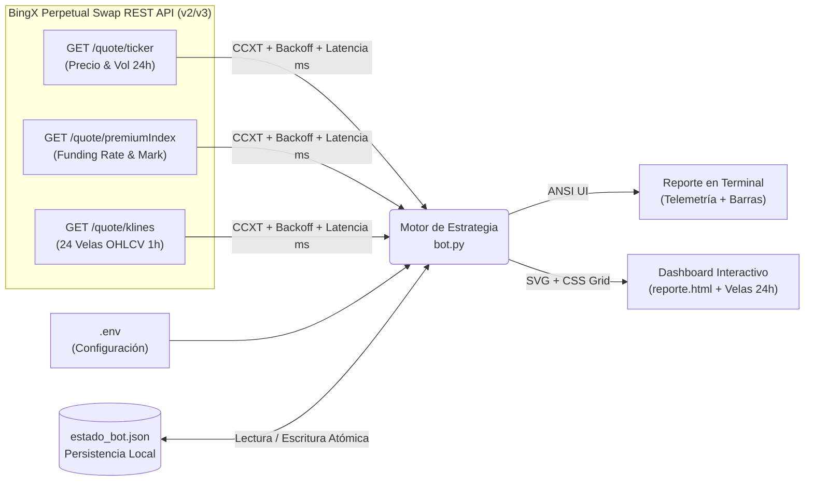

# 🎯 3 Cargadores — Bot Algorítmico DCA & Gestión de Margen (BingX)


-F26522?style=for-the-badge)


> **⚠️ AVISO LEGAL (DISCLAIMER): Este repositorio es un proyecto de código abierto desarrollado con el propósito de compartir proyectos y conocimientos técnicos de desarrollo de software. El bot opera estrictamente en modo simulación (`DRY_RUN=True`) consumiendo datos públicos de mercado y NO ejecuta órdenes con dinero real. Nada de lo contenido en este proyecto constituye asesoramiento financiero, recomendación de inversión ni invitación a operar derivados criptográficos.**

---

## 📌 Descripción General

**3 Cargadores** es un motor de simulación en Python para trading algorítmico sobre futuros perpetuos de Bitcoin (`BTC/USDT:USDT`) en el exchange **BingX**. Implementa una variante conservadora de **Dollar Cost Averaging (DCA)** combinada con **inyección defensiva de colateral en margen aislado**.

> 💡 **¿No venís del mundo cripto o de la programación?** Leé la **[Guía del Ecosistema Explicada desde Cero (`GUIA_ECOSISTEMA.md`)](./GUIA_ECOSISTEMA.md)**, pensada para que cualquier persona entienda qué hace este proyecto paso a paso y con analogías simples.

El proyecto fue diseñado para demostrar prácticas limpias de ingeniería en Python:
- **Separación de responsabilidades:** Funciones puras para la toma de decisiones cuantitativas desacopladas de la capa de red (`ccxt`) y de la persistencia.
- **Tolerancia a fallos de red:** Reintentos automáticos con *exponential backoff* ante caídas transitorias de la API y modo `--precio` para pruebas deterministas offline.
- **Persistencia atómica sin base de datos:** Escritura segura mediante archivos temporales (`.tmp` → `replace`) sobre `estado_bot.json`.
- **Observabilidad visual:** Reporte estilizado en consola con barras de progreso ANSI y generación de un dashboard estático autocontenido (`reporte.html`) con gráficos SVG nativos (cero dependencias JS/CSS externas).

---

## 🏗️ Arquitectura del Sistema y Consumo de APIs



### Componentes principales en `bot.py`
| Módulo / Sección | Responsabilidad |
|---|---|
| `Config` & `cargar_config()` | Carga tipada e inmutable (`@dataclass(frozen=True)`) de variables de entorno con validación defensiva. |
| `consultar_telemetria_bingx()` | Consume **3 endpoints REST públicos de BingX** (`fetch_ticker`, `fetch_funding_rate`, `fetch_ohlcv`) midiendo la latencia HTTP en milisegundos con reintentos exponenciales. |
| `Posicion` | Modelo matemático del contrato LONG aislado: cálculo de nocional, PnL no realizado, ROE (%) y precio de liquidación estimado. |
| `decidir_accion()` | Lógica pura de la estrategia DCA escalonada según tramos de PnL porcentual. |
| `ejecutar_dia()` | Orquestador de un ciclo diario: evalúa apertura, liquidación, Take Profit, escudo anti-liquidación y recargas DCA. |
| `imprimir_reporte()` | Renderizador CLI con telemetría de endpoints HTTP (`200 OK`, ms) y barras de progreso `[██████░░░░]`. |
| `generar_reporte_html()` | Generador de dashboard HTML5/SVG moderno con gráfico de **velas japonesas (OHLC 24h)** reales y tabla de auditoría de API. |

---

## 🧮 Estrategia Matemática: "3 Cargadores Conservadora"

### Parámetros Base
- **Activo:** `BTC/USDT:USDT` (Perpetual Swap Lineal).
- **Dirección y Apalancamiento:** `LONG` en **Margen Aislado** a **5X** ($L = 5$).
- **Capital Dividido en 90 "Balas":** Cada bala equivale a $V_b$ USDT de margen (por defecto `10 USDT`):
  - **Cargador 1 (30 balas):** Operativo diario para apertura y promediado inicial.
  - **Cargador 2 (30 balas):** Reserva táctica; entra en acción automáticamente cuando el Cargador 1 se agota.
  - **Cargador 3 (30 balas):** Reserva extrema exclusiva para inyección pura de colateral (`add_margin`).

### Fórmulas del Motor de Simulación

Cada compra de $b$ balas aporta un margen $\Delta M = b \cdot V_b$ y adquiere una cantidad de contratos:

$$\Delta Q = \frac{\Delta M \cdot L}{P_{\text{actual}}}$$

El nuevo precio promedio ponderado de entrada ($E'$) tras promediar sobre una posición existente $(Q, E)$ es:

$$E' = \frac{E \cdot Q + P_{\text{actual}} \cdot \Delta Q}{Q + \Delta Q}$$

El **PnL porcentual sobre el margen aislado (ROE)** y el **precio de liquidación** ($P_{\text{liq}}$, considerando una tasa de margen de mantenimiento $mm = 0.4\%$) se calculan como:

$$\text{PnL}_{\%} = \frac{(P_{\text{actual}} - E) \cdot Q}{M_{\text{total}}} \times 100 \qquad \text{y} \qquad P_{\text{liq}} = \frac{E \cdot Q - M_{\text{total}}}{Q \cdot (1 - mm)}$$

Cuando el bot inyecta margen defensivo ($\Delta M > 0$ con $\Delta Q = 0$), el denominador $M_{\text{total}}$ crece sin aumentar la exposición $Q$, reduciendo directamente $P_{\text{liq}}$ para alejar el riesgo de liquidación.

### Matriz de Reglas de Ejecución Diaria

| Condición / Tramo | Acción del Bot | Balas Consumidas | Origen de Fondos |
|---|---|---|---|
| **Sin posición abierta** | Abrir posición LONG a mercado | **2 balas** (compra) | `cargador_1` |
| **$\text{PnL}_{\%} \ge +15.0\%$** | **Take Profit:** Cerrar 100% (`reduceOnly`) y recargar los 90 cartuchos | — (Reinicia a 90) | — |
| **Distancia a $P_{\text{liq}} \le 6.0\%$** | **Escudo Anti-Liquidación:** Inyectar margen directo (se suma a la acción del día) | **5 balas** (margen) | `cargador_1` → `cargador_2` |
| **$-5.0\% < \text{PnL}_{\%} < +15.0\%$** | **Recarga Suave:** Promediar a mercado | **1 bala** (compra) | `cargador_1` → `cargador_2` |
| **$-15.0\% < \text{PnL}_{\%} \le -5.0\%$** | **Recarga Media:** Promediar a mercado | **2 balas** (compra) | `cargador_1` → `cargador_2` |
| **$-40.0\% < \text{PnL}_{\%} \le -15.0\%$** | **Recarga Fuerte:** Promediar a mercado | **3 balas** (compra) | `cargador_1` → `cargador_2` |
| **$-60.0\% < \text{PnL}_{\%} \le -40.0\%$** | **Defensa Crítica:** Mitad compra + mitad inyección de margen | **4 balas** (2 compra + 2 margen) | `cargador_1` → `cargador_2` |
| **$\text{PnL}_{\%} \le -60.0\%$** | **Defensa Terminal:** Prohibido comprar más BTC; 100% a margen aislado | **4 balas** (margen) | Exclusivo `cargador_3` |

---

## 🚀 Instalación

1. **Clonar el repositorio y entrar al directorio:**
   ```bash
   git clone <url-del-repositorio>
   cd Bot-traiding-ms
   ```

2. **Crear un entorno virtual (recomendado) e instalar dependencias:**
   ```bash
   python -m venv .venv
   # En Windows:
   .venv\Scripts\activate
   # En Linux / macOS:
   source .venv/bin/activate

   pip install -r requirements.txt
   ```

3. **Configurar variables de entorno (opcional):**
   ```bash
   cp .env.example .env
   ```
   *No necesitas completar `BINGX_API_KEY` ni `BINGX_SECRET_KEY`; el modo demostración consulta precios públicos sin autenticación.*

---

## 💻 Uso

### 1. Ejecución conectada a BingX (API Pública en tiempo real)
Obtiene la cotización actual de `BTC/USDT:USDT` en BingX, ejecuta un ciclo diario, imprime el estado en terminal y actualiza `estado_bot.json` y `reporte.html`:
```bash
python bot.py
```

### 2. Simulación de escenarios con precios manuales (Offline / Testing)
Puedes simular el paso de varios días y caídas/subidas de mercado pasando `--precio`:
```bash
python bot.py --reset --precio 95000   # Día 1: Abre ciclo LONG con 2 balas
python bot.py --precio 91000           # Día 2: Caída moderada -> Recarga Fuerte (3 balas)
python bot.py --precio 83000           # Día 3: Zona crítica -> Defensa Crítica (2 compra + 2 margen)
python bot.py --precio 94000           # Día 4: Recuperación > +15% ROE -> Take Profit y reinicio
```

### 3. Opciones disponibles por CLI
```text
python bot.py --help
  --precio PRECIO     Usar un precio manual en vez de consultar BingX
  --reset             Reiniciar la simulación desde cero (90/90 balas)
  --sin-html          No generar reporte.html al finalizar
  --estado RUTA       Ruta personalizada para estado_bot.json
  --reporte RUTA      Ruta personalizada para reporte.html
```

---

## 🖥️ Ejemplo de Salida en Terminal

```text
╭────────────────────────────────────────────────────────────────╮
│       3 CARGADORES · DCA BOT · BingX BTC/USDT:USDT · DEMO      │
╰────────────────────────────────────────────────────────────────╯
  Ejecución #4 · Ciclo #1 · 2026-11-11 15:40 UTC · precio: BingX API pública

  MERCADO & TELEMETRÍA API (BingX REST)
  ├─ Precio BTC ............ 74,477.90 USDT
  ├─ Rango 24h / Cambio .... 73,187.5 – 74,748.0 USDT (+1.29%)
  ├─ Volumen 24h / Funding . 745.2M USDT · Funding: +0.0056%
  ├─ GET /openApi/swap/v2/quote/ticker    200 OK (380.4 ms)
  ├─ GET /openApi/swap/v2/quote/premiumIndex 200 OK (393.9 ms)
  └─ GET /openApi/swap/v3/quote/klines    200 OK (411.7 ms)

  POSICIÓN SIMULADA · LONG 5X aislado
  ├─ Contratos ............. 0.00592 BTC  (491.36 USDT)
  ├─ Precio de entrada ..... 92,060.81
  ├─ Margen aislado ........ 130.00 USDT
  ├─ PnL no realizado ...... -53.64 USDT (-41.26%)
  ├─ Progreso a TP (+15%) .. [░░░░░░░░░░░░░░░]
  └─ Liquidación ........... 70,382.58 (a 15.20%)

  ACCIONES DE HOY
  ▸ Defensa crítica    compra 2 bala(s) (20.00 USDT) → 0.00120 BTC + margen +2 bala(s) (20.00 USDT) · origen C1×4

  CARGADORES
  C1 Operativo  [████████████░░░░░░░░] 18/30
  C2 Táctico    [████████████████████] 30/30
  C3 Extremo    [████████████████████] 30/30
  TOTAL         [█████████████████░░░] 78/90 Balas Restantes

  ESTADÍSTICAS
  Ciclos cerrados 0 · Liquidaciones 0 · PnL realizado +0.00 USDT
```

Al finalizar, abre **`reporte.html`** en cualquier navegador para explorar el dashboard visual con el estado bala por bala de cada cargador, las curvas SVG de PnL/Precio y la tabla de auditoría de eventos.
